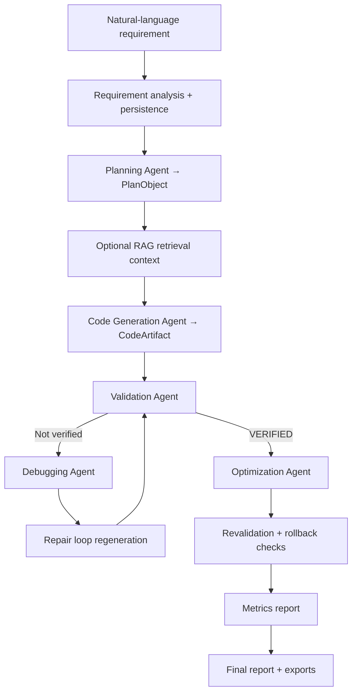

# OptPLC

OptPLC is a research prototype that generates, validates, repairs, optimizes, and evaluates IEC 61131-3 Structured Text (ST) programs from natural-language industrial control requirements. The repository contains a Next.js frontend, a FastAPI backend, SQLAlchemy persistence, LLM-assisted pipeline agents, compiler-backed syntax validation with domain-aware structural safety checks, and a benchmark runner for deterministic, LLM, and RAG comparisons.

> **Academic context:** Master's thesis project — Peter the Great St. Petersburg Polytechnic University.
>
> **Target standard:** IEC 61131-3 Structured Text (ST), CODESYS / TwinCAT compatible.

## Current Status

| Component | Status | Notes |
| --- | --- | --- |
| Project creation and persistence | Implemented | `POST /api/projects` with SQLAlchemy `projects` / `sessions` tables |
| Requirement analysis | Implemented | `POST /api/projects/{id}/analyze-requirement` used by the requirements preview UI |
| Planning (`PlanObject`) | Implemented | `PlanningAgent(mode="llm")` at runtime; RAG context included in planning |
| Code generation | Implemented | `CodeGenerationAgent(mode="llm")` at runtime; RAG not enabled on default `/generate` path |
| LLM provider abstraction | Implemented | Anthropic, OpenAI, Gemini, Groq, and Ollama via `LLM_PROVIDER` |
| RAG retrieval | Partial | Seeded at startup; active in planning and benchmark `llm_rag` mode |
| Validation | Implemented | `ValidationAgent(mode="static")` — MATIEC syntax check when available, plus domain-aware structural safety rules |
| Debugging / repair loop | Implemented | LLM debugging with iterative regeneration and revalidation |
| Optimization | Implemented | LLM optimization passes with post-pass revalidation and rollback tracking |
| Metrics | Implemented | LOC, cyclomatic complexity, maintainability index, estimated scan time |
| Benchmark runner | Implemented | `rule_based`, `llm`, and `llm_rag` modes with persisted result summaries |
| Final report | Implemented | Aggregated report with JSON and Markdown export |
| Formal verification (PLCverif / nuXmv) | Partial | `ValidationAgent(mode="formal")` exists but is not wired into the main workflow |

## Architecture



The frontend exposes a 9-step pipeline UI at project-scoped routes (`/projects/[id]/requirements` through `/projects/[id]/report`). The backend orchestrates agents through `ProjectService` and persists all pipeline state as JSON in the `sessions` table.

## Main Agents

| Agent | Input | Output | Runtime mode | Type |
| --- | --- | --- | --- | --- |
| Planning Agent | Requirement text, constraints, targets | `PlanObject` | `llm` | Hybrid (LLM + deterministic fallback) |
| Code Generation Agent | `PlanObject`, optional patch advice | `CodeArtifact` | `llm` | Hybrid (LLM + structured templates/fallback) |
| Validation Agent | `CodeArtifact` + `PlanObject` | `ValidationReport` | `static` | Deterministic (MATIEC syntax + structural safety rules) |
| Debugging Agent | Plan, artifact, validation report | `DebuggingReport` | `llm` | Hybrid |
| Optimization Agent | Artifact, plan, validation (+ repair report) | `OptimizationReport` | `llm` | Hybrid with revalidation guards |

Agent mode selection is currently hardcoded in `ProjectService` (plan, code, debug, and optimize use `llm`; validation uses `static`).

## Repository Structure

```text
OptPLC/
├── src/
│   ├── app/                    # Next.js routes (project-scoped pipeline pages)
│   ├── components/
│   │   ├── common/
│   │   ├── layout/
│   │   ├── pages/
│   │   └── ui/
│   ├── lib/
│   │   ├── api-client/
│   │   └── api-contracts/
│   └── test/
├── backend/
│   ├── app/
│   │   ├── agents/
│   │   ├── api/
│   │   ├── database/
│   │   ├── schemas/
│   │   ├── services/
│   │   └── tests/
│   ├── alembic/
│   ├── benchmark/
│   │   └── cases/
│   ├── knowledge_base/
│   │   └── patterns/
│   ├── requirements.txt
│   └── README.md
├── docker/
├── .env.example
├── docker-compose.yml
├── package.json
└── README.md
```

For backend-specific details (API routes, migrations, RAG paths, validation stages), see [backend/README.md](backend/README.md).

## Technology Stack

| Layer | Technologies |
| --- | --- |
| Frontend | Next.js 15, React 19, TypeScript 5, Tailwind CSS 3, shadcn/ui, Monaco Editor, Vitest |
| Backend | Python 3.11, FastAPI 0.136.1, SQLAlchemy 2.0 (async), Pydantic Settings, Alembic |
| LLM | Anthropic, OpenAI, Gemini, Groq, Ollama via unified client |
| RAG | ChromaDB 0.6.3, sentence-transformers 3.4.1 |
| Validation | MATIEC (`iec2c`), Lark-based ST parser, domain-aware safety rules |
| Persistence | SQLite (local dev) / PostgreSQL (deployment) |

## Quick Start

### Prerequisites

- Node.js 18+ and npm
- Python 3.11+
- An LLM API key for the provider selected in `.env` (see [Environment Variables](#environment-variables))

### Backend

```powershell
cd backend
python -m venv .venv
.\.venv\Scripts\Activate.ps1
python -m pip install -r requirements-dev.txt
uvicorn app.main:app --reload --port 8000
```

```bash
cd backend
python -m venv .venv
source .venv/bin/activate
python -m pip install -r requirements-dev.txt
uvicorn app.main:app --reload --port 8000
```

### Frontend

```bash
npm install
npm run dev
```

Open `http://localhost:3000`. The frontend expects the backend at `http://localhost:8000` by default.

### Docker Compose (backend only)

```bash
docker compose up --build
```

The compose service builds from `docker/app.Dockerfile`, exposes port 8000, and mounts the local `rag_db` volume for ChromaDB persistence.

## Environment Variables

Copy `.env.example` to `backend/.env` and `/.env.local` for the frontend. Do not commit real secrets.

| Group | Variables |
| --- | --- |
| Application | `MAX_ITER` |
| Database | `DATABASE_URL` (default SQLite file: `plcforge.db`) |
| LLM | `LLM_PROVIDER`, `LLM_MAX_TOKENS`, `LLM_TEMPERATURE`, plus provider-specific keys and models (`ANTHROPIC_*`, `OPENAI_*`, `GEMINI_*`, `GROQ_*`, `OLLAMA_*`) |
| Validation | `MATIEC_BIN`, `PLCVERIF_BIN`, `VERIFICATION_TIMEOUT_S` |
| Frontend / CORS | `NEXT_PUBLIC_API_BASE_URL`, `NEXT_PUBLIC_USE_MOCK_API`, `NEXT_PUBLIC_PLANNING_MODE` |

RAG storage paths are defined in service code (`rag_service.py`), not via environment variables.

## Testing

**Backend:**

```bash
cd backend
pytest
python -m compileall app
```

**Frontend:**

```bash
npm run typecheck
npm run lint
npm run test
npm run build
```

## Limitations

- Validation in the active runtime path is compiler-backed syntax checking plus domain-aware structural safety rules — not full temporal-logic model checking.
- `ValidationAgent(mode="formal")` and the ST→SMV transpiler exist in source, but formal mode is not selected by `ProjectService` for normal `/validate` calls.
- RAG is used during planning and in benchmark `llm_rag` mode; it is not enabled by default on the main `/generate` endpoint.
- Generated PLC code requires review by a qualified industrial control engineer before any deployment.
- Estimated scan time is a static proxy metric, not measured on real PLC hardware.
- LLM outputs vary by provider, model, and prompt context.
- Default SQLite storage suits local development and demos; production use requires a managed database.
- Some frontend views (dashboard, settings, workflow monitor) still use mock-only data paths.

## Roadmap

- Wire formal validation (`mode="formal"`) into the default workflow and complete PLCverif / nuXmv operational integration.
- Enable RAG on the default code-generation path with configurable retrieval.
- Expand the benchmark corpus and comparison analytics.
- Conduct broader industrial engineer evaluation studies.
- Add vendor-specific codegen targets and conformance profiles.
- Validate generated logic on real PLC hardware or digital-twin environments.

## Safety and Research Disclaimer

OptPLC is a research prototype for academic and engineering evaluation. It is **not** production-ready, formally certified, or suitable for safety-critical deployment without independent verification. It does not provide SIL certification or production safety guarantees. Never deploy generated control logic without qualified engineer review and appropriate site-specific testing.
