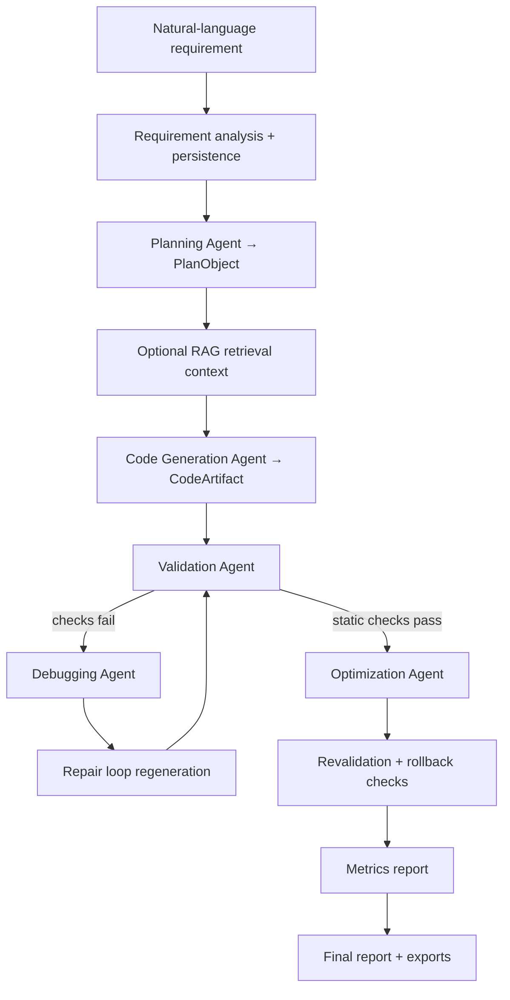

# OptPLC

OptPLC is a research prototype that generates, checks, repairs, optimizes, and evaluates IEC 61131-3 Structured Text (ST) programs from natural-language industrial control requirements. The repository contains a Next.js frontend, a FastAPI backend, SQLAlchemy persistence, LLM-assisted pipeline agents, a MATIEC-backed syntax check with heuristic domain rules, and a benchmark runner for deterministic, LLM, and RAG comparisons.

> **Academic context:** Master's thesis project, Peter the Great St. Petersburg Polytechnic University.
>
> **Target standard:** IEC 61131-3 Structured Text (ST), CODESYS / TwinCAT compatible.
>
> **Plan, status, and decisions:** [`docs/plan/`](docs/plan/README.md). Start with [`docs/plan/STATUS.md`](docs/plan/STATUS.md).

## Current Status

This table describes what the code does today, not what is planned. Findings are tracked in [`docs/plan/AUDIT_2026-09.md`](docs/plan/AUDIT_2026-09.md) and [`docs/plan/TEST_BASELINE.md`](docs/plan/TEST_BASELINE.md).

| Component | Status | Notes |
| --- | --- | --- |
| Project creation and persistence | Implemented | `POST /api/projects`, SQLAlchemy `projects` / `sessions` tables |
| Requirement analysis | Implemented | `POST /api/projects/{id}/analyze-requirement` (LLM, heuristic fallback in the UI) |
| Planning (`PlanObject`) | Implemented | LLM mode with a rule-based fallback when the reply is not JSON |
| Code generation | Implemented | LLM mode with a template fallback; RAG is not enabled on `/generate` |
| LLM provider abstraction | Implemented | Anthropic, OpenAI, Gemini, Groq, Ollama via `LLM_PROVIDER` |
| RAG retrieval | Partial | 12 patterns; used in planning and in benchmark `llm_rag` mode; storage paths are hard-coded to `/app/...` |
| Validation | Partial | MATIEC compile when available (the source is normalized first), otherwise a regex fallback that currently rejects valid programs (C-01); then heuristic domain rules. The status `VERIFIED` means "static checks passed", not a proof |
| Debugging / repair loop | Implemented, with a known defect | The repair prompt shows the template code instead of the failed code (C-02) |
| Optimization | Partial | LLM passes with static revalidation and rollback; behavioural equivalence is not checked (C-03) |
| Metrics | Implemented | LOC, cyclomatic complexity, a maintainability-index variant, and a static cost proxy that is not milliseconds (M-03) |
| Benchmark runner | Partial | 5 cases (B001–B005); `expected_properties` are not evaluated; no valid LLM results are stored yet |
| Final report | Implemented | JSON and Markdown export |
| Formal verification (PLCverif / nuXmv) | Scaffold | `ValidationAgent(mode="formal")` exists but is not wired in; the ST→SMV transpiler cannot yet produce usable models |

## Architecture



The frontend exposes a 9-step pipeline UI at project-scoped routes (`/projects/[id]/requirements` through `/projects/[id]/report`). The backend runs each step through `ProjectService` and persists pipeline state as JSON in the `sessions` table. A deterministic orchestrator is planned (decision D-013).

## Repository Structure

```text
OptPLC/
├── src/                 # Next.js app, components, API client and contracts
├── backend/
│   ├── app/             # agents, api, database, schemas, services, tests
│   ├── alembic/
│   ├── benchmark/cases/
│   └── knowledge_base/patterns/
├── docker/app.Dockerfile
├── scripts/             # check.ps1, st-compile.ps1, backup_runtime_data.py
├── docs/plan/           # plan, status, backlog, decisions, changelog, audit, test baseline
├── docker-compose.yml
└── package.json
```

Backend details (API routes, migrations, validation stages) are in [backend/README.md](backend/README.md).

## Technology Stack

| Layer | Technologies |
| --- | --- |
| Frontend | Next.js 15, React 19, TypeScript 5, Tailwind CSS 3, shadcn/ui, Monaco Editor, Vitest |
| Backend | Python 3.11, FastAPI, SQLAlchemy 2.0 (async), Pydantic Settings, Alembic |
| LLM | Anthropic, OpenAI, Gemini, Groq, Ollama via a unified client |
| RAG | ChromaDB 0.6.3, sentence-transformers 3.4.1 |
| Validation | MATIEC (`iec2c`), Lark-based ST parser (metrics), heuristic domain rules |
| Persistence | SQLite (local dev) |

## Quick Start

### Backend

```powershell
cd backend
python -m venv .venv
.\.venv\Scripts\Activate.ps1
python -m pip install -r requirements-dev.txt
uvicorn app.main:app --reload --port 8000
```

### Frontend

```bash
npm install
npm run dev
```

Open `http://localhost:3000`. The frontend expects the backend at `http://localhost:8000`. If `NEXT_PUBLIC_USE_MOCK_API` is not set, the frontend runs in mock mode and shows demo data.

### Reference image (Docker)

```bash
docker build -f docker/app.Dockerfile -t optplc-backend:p0-05 .
```

The image builds MATIEC from a pinned commit, installs Python dependencies from the hashed lock `backend/requirements-docker.lock` (CPU-only PyTorch), and runs as a non-root user with a health check. Results reported in the thesis come from this image. `docker-compose.yml` still uses the older service name and mounts; it is updated in a later item.

## Environment Variables

Copy `.env.example` to `backend/.env` and `/.env.local`. Do not commit real secrets.

| Group | Variables |
| --- | --- |
| Application | `MAX_ITER` |
| Database | `DATABASE_URL` (default SQLite file: `plcforge.db`) |
| LLM | `LLM_PROVIDER`, `LLM_MAX_TOKENS`, `LLM_TEMPERATURE`, plus provider keys and models (`ANTHROPIC_*`, `OPENAI_*`, `GEMINI_*`, `GROQ_*`, `OLLAMA_*`) |
| Validation | `MATIEC_BIN`, `PLCVERIF_BIN`, `VERIFICATION_TIMEOUT_S` |
| Frontend | `NEXT_PUBLIC_API_BASE_URL`, `NEXT_PUBLIC_USE_MOCK_API`, `NEXT_PUBLIC_PLANNING_MODE` |

RAG storage paths are defined in `rag_service.py` (`/app/rag_db`, `/app/knowledge_base/patterns`), not in environment variables; on Windows they resolve to the current drive (for example `E:\app\...`).

## Testing and Checks

Run everything before merging:

```powershell
powershell -ExecutionPolicy Bypass -File scripts\check.ps1
```

It runs `tsc`, `eslint`, `vitest`, the hermetic backend tests, and a report-only dependency audit. Backend tests use a temporary database, a fake LLM provider, a fake RAG service, and a network guard. Known failures are listed in `backend/app/tests/known_failures.txt`, and the check fails only on new ones. **Run backend tests only from `staging` or branches taken from it**; older branches still point the tests at the development database.

Compile a single ST file with the pinned MATIEC:

```powershell
powershell -ExecutionPolicy Bypass -File scripts\st-compile.ps1 -Path path\to\program.st
```

## Limitations

- Validation is a compiler check plus heuristic text rules, not model checking. A program that ignores its emergency stop can pass the motor rules.
- The MATIEC path compiles a normalized copy of the source (timer calls removed, `X.Q` replaced by `FALSE`, `T#` literals replaced by `0`).
- The motor and batch templates are behaviourally wrong (C-10, C-11), yet pass the static rules.
- RAG is used in planning and in benchmark `llm_rag` mode only, and its effect has not been measured.
- The static cost proxy is not a scan time measured on PLC hardware.
- There is no authentication or rate limiting on the API.
- Generated PLC code requires review by a qualified control engineer before any deployment.

## Roadmap

See [`docs/plan/MASTER_PLAN.md`](docs/plan/MASTER_PLAN.md): an evidence ladder from compile checks to formal proofs and hardware-in-the-loop tests, organized in phases 0–8 with Orchestrator and RAG tracks, scheduled to finish by 2027-05-30.

## Safety and Research Disclaimer

OptPLC is a research prototype for academic and engineering evaluation. It is **not** production-ready, formally certified, or suitable for safety-critical deployment without independent verification. It does not provide SIL certification or production safety guarantees. Safety functions such as emergency stops belong in certified safety controllers or relays. Never deploy generated control logic without qualified engineer review and appropriate site-specific testing.
