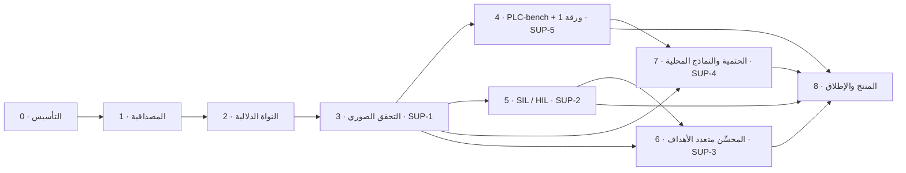

# الخطة الرئيسية لتنفيذ OptPLC

**الإصدار:** 1.2 (2026-09-14). الحالة: **مقبولة** (`D-002`، `D-022`).

**تغييرات الإصدار 1.2:**

- الجدول الزمني مضغوط لينتهي في 2027-05-30 قبل المناقشة المتوقعة في يونيو 2027 (§5، `D-022`)، دون حذف أي مرحلة أو بند.
- أُضيف إلى بروتوكول العمل ملخص للمرحلة التالية يُكتب ويُعرض عليك عند إغلاق كل مرحلة (`README.md`).

**تغييرات الإصدار 1.1:**

- أُضيف مساران عرضيان للمنسِّق والـ RAG (§4ب، `D-013`، `D-014`).
- التجارب تعمل بلا ميزانية، بنماذج محلية أو مجانية (`D-008`). عتاد جهازك (GPU بذاكرة 4 GB) يجعل التدريب في المرحلة 7 يعتمد على GPU سحابي مجاني.
- الحالات الـ 15 الناقصة يجب تأليفها (`D-016`، `P2-12`).
- الفحص المستمر بسكربت محلي بدل GitHub Actions (`D-015`).
**المصادر:** [تدقيق 2026-09-13](AUDIT_2026-09.md) وملاحظات المشرف (`SUP-1` إلى `SUP-5`).
**تفاصيل البنود:** [BACKLOG.md](BACKLOG.md). **ما المطلوب منك:** [USER_INPUTS.md](USER_INPUTS.md).

---

## 1. الهدف النهائي

**المنتج:** مساعد هندسي لبرامج PLC يولّد كود IEC 61131-3 من المتطلبات، ثم **يُثبت** خصائص السلامة صوريًا، و**يختبر** الكود على محاكاة وعلى PLC حقيقي، ويسلّم مع كل برنامج **ملف أدلة قابلًا للتدقيق** يربط كل متطلب بالكود وبالإثبات وبنتيجة الاختبار.

**العميل الأول المستهدف:** شركات تكامل الأنظمة (system integrators) التي تسلّم مشاريع CODESYS وتحتاج توثيق اختبارات القبول (FAT/SAT).

**لماذا يمكن أن ينافس:** توليد الكود وحده سوق خاسر أمام من يملك بيئة التطوير، مثل Siemens Industrial Copilot. الميزة التي نبنيها أربعة أشياء لا يقدمها المورد عادةً:

1. أدلة تحقق مستقلة.
2. حياد تجاه المورد (مخرج PLCopen XML، مع ملف تعريف SCL لـ Siemens).
3. تشغيل محلي كامل.
4. فاحص يعمل حتى على الكود المكتوب يدويًا.

**ما لسنا عليه (non-goals):**

- لا نولّد منطق سلامة وظيفية (وظائف SIL أو PL). وظائف الطوارئ تبقى في PLC سلامة معتمد أو مرحلات سلامة.
- لا نحمّل كودًا إلى جهاز إنتاج.
- لا ندّعي ما لم نقِسه.

## 2. مبادئ العمل

1. **مولّد غير موثوق وفاحص موثوق.** الـ LLM يقترح، والفاحص يحكم. لا يُقبل أي مُخرَج إلا عبر الفاحص.
2. **فشل مغلق (fail-closed).** أي مخرجات غير مفهومة من أداة تحقق تعني "غير متحقق"، لا "ناجح".
3. **سُلّم أدلة صريح.** لكل مُخرَج مستوى أدلة واحد معلن (القسم 3)، ولا يُستخدم وصف أعلى منه.
4. **كل مرحلة تفتح مستوى أدلة جديدًا** وتبني على ما قبلها. لذلك الترتيب ليس اختياريًا.
5. **القياس قبل الادعاء.** كل رقم يُنشر يُعاد إنتاجه من ملف manifest يحدد النموذج والإعدادات والبذور.
6. **مصدر واحد للحقيقة.** مجلد `docs/plan/` للحالة والقرارات، والكود للسلوك. الفرق بينهما خلل يُصلح فورًا.
7. **أسألك في كل خطوة.** لا قرار ولا commit ولا عملية مدمرة دون موافقتك.

## 3. سُلّم الأدلة (Evidence Ladder)

هذا هو العمود الفقري للخطة. كل مستوى تفتحه مرحلة، وكل مستوى شرط للذي بعده:

| المستوى | الاسم في الكود | المعنى | تفتحه المرحلة |
| --- | --- | --- | --- |
| L0 | `GENERATED` | كود مولَّد لم يُفحص | موجود |
| L1 | `COMPILES` | يُترجم في MATIEC **بلا أي تعديل** على النص | 1 |
| L2 | `STATIC_RULES_PASSED` | يجتاز قواعد ساكنة موثقة (استدلالية، لا تُثبت شيئًا) | 1 |
| L3 | `SIMULATION_TESTED` | يجتاز الخصائص على متجهات اختبار في محاكي دورة المسح | 2 |
| L4 | `PROPERTIES_PROVEN` | خصائص السلامة مُثبتة بـ nuXmv لكل المدخلات | 3 |
| L5 | `HIL_PASSED` | يجتاز السيناريوهات على PLC (افتراضي أو حقيقي) مع زمن دورة مقاس | 5 |
| L6 | `ENGINEER_APPROVED` | اعتمده مهندس مسجّل، مع توقيع وبصمة | 8 |

كلمة "verified" في الأطروحة والواجهة تعني **L4 فأعلى** فقط.

## 4. خريطة الاعتماد بين المراحل

**لماذا هذا الترتيب؟**

- المراحل 0 ثم 1 ثم 2 ثم 3 سلسلة إلزامية. لا يمكن إثبات خصائص (3) بلا نموذج دلالي للبرنامج (2)، ولا قياس أي تقدم بمقياس معطوب (1)، ولا العمل بأمان بلا اختبارات معزولة وبيئة قابلة للإعادة (0).
- بعد المرحلة 3 تتفرع ثلاثة مسارات مستقلة: 4 و5 و7. الثلاثة تحتاج الفاحص الصوري ولا يحتاج أي منها الآخر، باستثناء أن 7 تستفيد من benchmark المرحلة 4 للتقييم.
- المرحلة 6 تحتاج فحص التكافؤ من 3 ونموذج كلفة مُعايَرًا من 5.
- المرحلة 8 تجمع كل شيء. بعض عناصرها المنصّية يبدأ مبكرًا، مثل الطابور في 2 والحماية الدنيا في 1.

## 4ب. مساران عرضيان: المنسِّق (Orchestrator) والـ RAG

أُضيف هذان المساران بطلبك في 2026-09-14. لا يشكل أي منهما مرحلة مستقلة، بل تضيف كل مرحلة لهما قدرة جديدة، ويخضع كلاهما لسُلّم الأدلة نفسه.

### المنسِّق (Orchestrator)

**الوضع الحالي:** لا يوجد منسِّق. الواجهة تستدعي الخطوات التسع واحدة واحدة، والتنسيق مبعثر داخل `ProjectService` (1036 سطرًا)، وحلقة الإصلاح مكررة في `benchmark_runner.py`.

**المبدأ (`D-013`):** المنسِّق **آلة حالات حتمية مكتوبة في الكود**، لا وكيل LLM حر.

- البوابات تُفرض في الكود ولا يستطيع أي LLM تجاوزها: مستويات الأدلة، والموافقات البشرية، والميزانيات.
- الـ LLM يعمل **داخل** العقد: التخطيط، والتوليد، والتصحيح، والتحسين.
- في المرحلة 7 يمكن أن يُضاف "مشرف LLM" يختار فقط من أفعال محدودة: أعد التوليد، أو أعد التخطيط، أو اطلب توضيحًا من المهندس، أو توقف. ولا يُعتمد إلا إذا تفوّق على السياسة الثابتة في تجربة مقاسة.

**لماذا؟** مسار ينتج كود تحكم صناعي يجب أن يكون قابلًا للتدقيق والإعادة. قرار تحكم يتخذه LLM دون قيود يكسر قابلية الإعادة ويفتح بابًا لحقن الأوامر النصية. ثم إن المنسِّق هو المكان الذي تعيش فيه الحلقتان المزدوجتان، فإثبات التقارب الذي يطلبه المشرف في `SUP-4` هو في الحقيقة إثبات لخصائص سياسة المنسِّق.

| المرحلة | ما يضيفه للمنسِّق | البنود |
| --- | --- | --- |
| 1 | مواصفة آلة الحالات: الحالات، والانتقالات، والبوابات، ونقاط التوقف البشرية، والميزانيات، والأحداث. مع حلقة إصلاح واحدة مشتركة | `P1-21`، `P1-06` |
| 2 | المنسِّق v1: محرك حتمي فوق طابور المهام، وحالة تشغيل محفوظة قابلة للاستئناف، وأحداث تُبث للواجهة، وميزانيات (زمن، tokens، تكرارات)، ونقاط توقف بشرية لتأكيد الإشارات والخصائص | `P2-10`، `P2-11`، `P2-15` |
| 3 | سياسة CEGIS: مثال مضاد ثم تصحيح ثم إعادة إثبات، مع كشف الدوران وبوابة L4 | `P3-12` |
| 5 | مرحلة HIL مع بوابة الموافقة على التحميل | `P5-09` |
| 6 | حلقة المحسِّن كمرحلة منسقة: مرشحون ثم فلتر التكافؤ ثم جبهة باريتو ثم اختيار المهندس | `P6-08` |
| 7 | قاعدة قبول مضمونة الإنهاء (من فصل التقارب)، ومشرف LLM اختياري يُقارن بالسياسة الثابتة | `P7-06`، `P7-09` |
| 8 | سجل قرارات المنسِّق يغذي ملف الأدلة، وتشغيلات معزولة لكل عميل | `P8-13` |

### الـ RAG

**الوضع الحالي (مقاس في 2026-09-14):**

- 12 نمطًا في `knowledge_base/patterns/`، كتبها المؤلف نفسه، ولم يُترجم أي مقطع ST منها في MATIEC.
- نموذج التضمين `all-MiniLM-L6-v2` إنجليزي فقط، ويُضمَّن الوصف والوسوم فقط دون مقاطع الكود.
- يعمل دائمًا في التخطيط، ولا يعمل في التوليد إلا في وضع `llm_rag` للـ benchmark.
- المسارات مثبتة على `/app`:
  - المخزن `E:\app\rag_db` فيه **0 تضمينات**، أي أنه فارغ.
  - المخزن المملوء هو `./rag_db` في جذر المشروع، وفيه 12 تضمينًا من تشغيل Docker.
  - المخزنان يُعاد بناؤهما من ملفات JSON، فهما ذاكرة مؤقتة وليسا مصدرًا.
- لا يوجد أي قياس لجودة الاسترجاع، ولا لأثره على النتائج.

**المبدأ (`D-014`):** قاعدة معرفة **مُتحقَّق منها**:

- كل مقطع ST فيها يجتاز L1 على الأقل، ثم L3 وL4 عندما يتوفران.
- لكل عنصر مصدر وترخيص معروفان.
- لا يدخلها أي حل مرجعي من PLC-bench، منعًا للتلوث.
- أثر الـ RAG يُقاس بتجارب ablation ولا يُفترض.

| المرحلة | ما يضيفه للـ RAG | البنود |
| --- | --- | --- |
| 1 | إصلاح الأساسيات: المسارات من الإعدادات، وفشل ظاهر عند وجود 0 أنماط، وتسجيل المصادر المسترجعة مع كل استدعاء LLM، وتفعيله أو تعطيله في التوليد من الإعدادات | `P1-20` |
| 2 | قاعدة المعرفة v2: مخطط موحد (نمط، مقطع، خصائص، أخطاء شائعة، مصدر، ترخيص، لهجة)، وتحقق آلي من كل مقطع، وأنواع محتوى جديدة (كتل IEC القياسية، أنماط سلامة)، وتضمين متعدد اللغات، وبحث هجين (BM25 مع المتجهات) بفلاتر المجال واللهجة | `P2-13` |
| 2 | مجموعة تقييم للاسترجاع (استعلام ثم الأنماط الصحيحة) بمقاييس recall@k وMRR، وقياس للنظام الحالي كخط أساس | `P2-14` |
| 3 | RAG للخصائص (استرجاع أنماط Dwyer المناسبة للمتطلب) ولإصلاح الأمثلة المضادة (استرجاع أنماط الإصلاح حسب نوع الانتهاك) | `P3-11` |
| 4 | تجارب ablation: بلا RAG، ثم بالأنماط، ثم بالأنماط والخصائص، مع فحص التلوث مقابل PLC-bench | `P4-08` |
| 5 | وثائق اللهجات (CODESYS، SCL) وكتل المورد في قاعدة المعرفة | `P5-08` |
| 7 | مقارنة RAG وfine-tuning والاثنين معًا، ونموذج تضمين محلي | `P7-08` |
| 8 | **ميزة منتج:** قاعدة معرفة خاصة بكل عميل تحوي معايير شركته ومكتباتها، مع عزل بين العملاء وحماية من تسميم قاعدة المعرفة | `P8-12` |

**القيمة التجارية:** عبارة "يتعلم معايير شركتك وكتلها البرمجية ويُثبت أن الكود يلتزم بها" ميزة يصعب على المورد العام تقديمها، وتدعم التشغيل المحلي.

## 5. الجدول الزمني (تقديري)

يبدأ الأسبوع 1 يوم 2026-09-14. الجدول يفترض عملك بدوام شبه كامل وأنا أنفّذ الكود. المراحل 4 و5 و6 و7 متداخلة لأن كثيرًا منها ينتظر مدخلات خارجية (عتاد، مراجعين، GPU). إذا تأخرت هذه المدخلات تتأخر مراحلها، لا المراحل الأخرى.

| المرحلة | الأسابيع | من | إلى | يعتمد على |
| --- | --- | --- | --- | --- |
| 0 · التأسيس | 1–2 | 2026-09-14 | 2026-09-27 | — |
| 1 · المصداقية | 3–6 | 2026-09-28 | 2026-10-25 | G0 |
| 2 · النواة الدلالية | 7–11 | 2026-10-26 | 2026-11-29 | G1 |
| 3 · التحقق الصوري (SUP-1) | 12–18 | 2026-11-30 | 2027-01-17 | G2 |
| 4 · PLC-bench + ورقة 1 (SUP-5) | 16–22 | 2026-12-28 | 2027-02-14 | G3 (إدخال الحالات يبدأ في 2) |
| 5 · SIL / HIL (SUP-2) | 17–27 | 2027-01-04 | 2027-03-21 | G3 |
| 7 · الحتمية والنماذج المحلية (SUP-4) | 19–31 | 2027-01-18 | 2027-04-18 | G3، G4 |
| 6 · المحسِّن (SUP-3) | 23–31 | 2027-02-15 | 2027-04-18 | G3، G5 |
| 8 · المنتج والإطلاق | 28–37 | 2027-03-22 | 2027-05-30 | الكل |
| كتابة الأطروحة | 30–35 | 2027-04-05 | 2027-05-16 | نتائج 3 إلى 6 |

**هذا الجدول مضغوط (D-022):** 37 أسبوعًا بدل 52، ينتهي قبل المناقشة المتوقعة في يونيو 2027 (U-41)، دون حذف أي مرحلة أو بند. الجدول السابق (1.1) كان ينتهي في 2027-09-12.

**مواعيد الأوراق:**

- الورقة 1: نهاية المرحلة 4 (فبراير 2027).
- الورقة 3 (المحسِّن مع HIL): نهاية المرحلة 6 (أبريل 2027).
- الورقة 2 (PLC-bench v1.0): مايو 2027.

**مدخلات يجب طلبها مبكرًا:**

- العتاد وCODESYS (U-21 إلى U-24) قبل ديسمبر 2026.
- حساب GPU (U-26) قبل يناير 2027.
- مهندسو الدراسة (U-25) قبل فبراير 2027.
- جهة الـ pilot (U-30) قبل مارس 2027.

---

## 6. المراحل بالتفصيل

لكل مرحلة: الهدف، والبنود (تفاصيلها في BACKLOG)، وبوابة الخروج، وما تفتحه لما بعدها، وما المطلوب منك، وأسئلة البداية التي سأطرحها عليك قبل أول بند.

### المرحلة 0 · التأسيس وشبكة الأمان

- **الهدف:** حلقة تطوير آمنة وقابلة للإعادة. لا يتغير أي منطق في هذه المرحلة.
- **البنود:** من `P0-01` إلى `P0-09`: التوثيق، والنسخ الاحتياطي، وعزل الاختبارات، وبيئة Docker مرجعية مع MATIEC مثبت الإصدار، وسكربت ترجمة، وإصلاح الاختبار الفاشل، وCI، وتحديث الوثائق القديمة، والتنظيف.
- **بوابة `G0`:**
  - [ ] اختبارات الخلفية تعمل بلا شبكة ولا تلمس `backend/plcforge.db`.
  - [ ] حصيلتها الأولية مسجلة كما هي.
  - [ ] `docker compose build` ينجح.
  - [ ] `/api/health` يُظهر MATIEC متاحًا، وبرنامج ST بسيط يُترجم داخل الحاوية.
  - [ ] `vitest` يجتاز 113 من 113.
  - [ ] العمل غير المُثبت محسوم.
  - [ ] سكربت الفحص المحلي `scripts/check.ps1` ينجح (بديلًا عن GitHub Actions، D-015).
- **ما تفتحه:** كل تغيير لاحق يُختبر بأمان في بيئة مطابقة لبيئة النتائج.
- **المطلوب منك:** من `U-01` إلى `U-06`.
- **أسئلة البداية:** سياسة الفروع، وهل المستودع خاص، ومصير الفرع القديم.

### المرحلة 1 · استعادة المصداقية

- **الهدف:** أن يكون كل مُخرَج حالي صحيحًا وصادق التسمية، وأن نحصل على أول قياسات صادقة (**Baseline v0**). بعدها يصبح لدينا مقياس نثق به.
- **البنود:** من `P1-01` إلى `P1-18`، في أربعة محاور:
  - التحقق: إصلاح المدقق الاحتياطي، وتشغيل MATIEC على الكود الأصلي، وتجربة المؤقتات، وسُلّم الأدلة L0 إلى L2 في العقود والواجهة، وكتالوج القواعد.
  - الوكلاء: حلقة الإصلاح بالكود الفعلي، واحتساب الرجوع إلى القوالب، وإصلاح التخطيط والتحليل، وتقييد المحسِّن مؤقتًا.
  - المنصة: سلسلة نسب المُخرَجات، وعميل LLM موحد مع سجل كل استدعاء، وإصلاحات صغيرة، وحماية دنيا.
  - التقييم: مجموعة الطفرات v0، ومُشغِّل benchmark قابل للإعادة، ومراجعة المنافسين، وتشغيل Baseline v0.
- **بوابة `G1`:**
  - [ ] القوالب الخمسة تُترجم في MATIEC دون تعديل، أو يُوثَّق سبب فشل كل منها.
  - [ ] لا تظهر كلمة "verified" لأي نتيجة دون L4.
  - [ ] نسبة كشف الطفرات للمدقق الساكن مقاسة ومسجلة.
  - [ ] تقرير `docs/research/baseline-v0.md` موجود بإعدادات كاملة وقابل للإعادة.
  - [ ] كل استدعاء LLM مسجل.
- **ما تفتحه:** مقياس صادق نقارن به كل المراحل التالية، وهو دليل "قبل" للأطروحة.
- **المطلوب منك:** من `U-07` إلى `U-11`.
- **أسئلة البداية:**
  - أي مزود ونموذج نعتمد للتجارب، وما الميزانية؟
  - كيف نعرّف خط الأساس؟
  - هل نحذف تطبيع MATIEC أم نحوّله إلى تحذيرات؟

### المرحلة 2 · النواة الدلالية

- **الهدف:** فهم حقيقي لبرامج ST: محلل ثم AST مكتوب الأنواع ثم تمثيل وسيط (IR) ثم محاكي دورة مسح، ومعها لغة خصائص مقيدة وصيغة موحدة للتتبعات. هذه النواة يحتاجها `SUP-1` و`SUP-2` و`SUP-3` و`SUP-5` كلها.
- **البنود:** من `P2-01` إلى `P2-12`:
  - مواصفة مجموعة ST المدعومة، ومحلل كامل، وIR، ومحاكٍ يدعم `TON/TOF/TP/R_TRIG/F_TRIG/CTU/SR/RS`.
  - تحقق تفاضلي للمحاكي مقابل كود C الذي يولّده MATIEC.
  - صيغة متجهات الاختبار، ولغة الخصائص على أنماط Dwyer.
  - توسيع `PlanObject` (نوع التلامس NO/NC، الوحدات، الأدوار) مع شاشة تأكيد المهندس.
  - مستوى L3، وطابور مهام مع بث التقدم، وتفكيك `ProjectService`، وبدء إدخال حالات PLC-bench.
- **بوابة `G2`:**
  - [ ] المحاكي يتفق مع MATIEC-C على 1000 تتبع عشوائي أو أكثر لكل قالب، أو تُوثَّق كل الاختلافات.
  - [ ] كل قيود B001 إلى B005 قابلة للتعبير بلغة الخصائص.
  - [ ] نسبة كشف الطفرات بالمحاكاة (L3) مقاسة.
  - [ ] العمليات الطويلة تعمل كمهام مع تقدم ظاهر.
- **ما تفتحه:** نموذج دلالي واحد يُولَّد منه SMV (المرحلة 3)، وتُعاد عليه المتجهات في HIL (5)، ويُختبر به التكافؤ (6)، وتُبنى عليه حالات الـ benchmark (4).
- **المطلوب منك:** من `U-12` إلى `U-14`.
- **أسئلة البداية:**
  - أي لهجة نستهدف أولًا: CODESYS أم IEC خالص أم SCL؟
  - هل تتوفر عينات برامج حقيقية؟
  - هل توافق على Redis للطابور؟

### المرحلة 3 · دارة التحقق الصوري (SUP-1)

- **الهدف:** تحقيق النقطة 1 من المشرف كاملة:
  - ترجمة آلية موثقة رياضيًا من IR إلى SMV بدلالة المسح.
  - خصائص LTL وثوابت (invariants) تُولَّد من المواصفة بتأكيد المهندس.
  - nuXmv بفشل مغلق.
  - أمثلة مضادة تصبح قيودًا ملزمة لوكيل التصحيح واختبارات انحدار (حلقة CEGIS).
- **البنود:** من `P3-01` إلى `P3-10`:
  - المستند الصوري، ومولّد SMV، وتكامل nuXmv، وترجمة لغة الخصائص مع الثوابت التلقائية.
  - تحقق تفاضلي للمولّد، ومسار المثال المضاد إلى وكيل التصحيح.
  - فحص التكافؤ التسلسلي (miter)، وPLCverif كمرجع اختياري.
  - مستوى L4، والقياسات.
- **بوابة `G3`:**
  - [ ] كل قيود الحالات مصاغة صوريًا، أو معلنة صراحةً "غير قابلة للصياغة".
  - [ ] مثال مضاد واحد على الأقل أُصلح آليًا وصار اختبار انحدار.
  - [ ] اختبارات الفشل المغلق تنجح.
  - [ ] فحص التكافؤ يكشف تعديلًا يغيّر السلوك.
  - [ ] مسودة المستند الصوري راجعتها أنت والمشرف.
  - [ ] جدول مقارنة الكشف (ساكن، محاكاة، صوري) جاهز.
- **ما تفتحه:** L4، وهو أول مستوى يحق فيه قول "verified". ويفتح المسارات 4 و5 و6 و7.
- **المطلوب منك:** من `U-15` إلى `U-17`، وأهمها قبول ترخيص nuXmv وقرار الترخيص التجاري (`D-010`).
- **أسئلة البداية:**
  - nuXmv للبحث مقابل بديل مفتوح للمنتج؟
  - هل نجرّب PLCverif؟

### المرحلة 4 · PLC-bench v0.1 والورقة 1 (SUP-5، الجزء الأول)

- **الهدف:** benchmark مفتوح. لكل مهمة فيه:
  - متطلب بلغتين.
  - جدول إشارات مع NO/NC.
  - خصائص صورية.
  - حل مرجعي مُثبت.
  - متجهات مخفية.
  - مُقيّم في Docker.

  ثم تجارب إحصائية سليمة تنتهي بتقديم الورقة 1.
- **البنود:** من `P4-01` إلى `P4-07`: المخطط، و20 حالة أو أكثر، والمُقيّم (pass@k على الترجمة والخصائص والمحاكاة)، والبروتوكول الإحصائي، والمقارنة مع LLM4PLC وAgents4PLC، والتجارب مع ablation للـ RAG والحلقة، والوسم.
- **بوابة `G4`:**
  - [ ] PLC-bench v0.1 موسوم في git، وكل حالة فيه تُترجم وتُثبت.
  - [ ] الورقة 1 مقدمة.
- **ما تفتحه:** مقياس خارجي لتقييم النماذج المحلية (المرحلة 7)، ومصداقية أكاديمية للمنتج.
- **المطلوب منك:** من `U-18` إلى `U-20`: مراجعو الحالات، والترخيص، والمجلة المستهدفة.

### المرحلة 5 · من المحاكاة إلى HIL (SUP-2)

- **الهدف:** سُلّم من ثلاث درجات:
  1. OpenPLC (المبني على MATIEC نفسه).
  2. CODESYS Control Win، ويغطي OWEN لأن طرازاتها الحديثة مبنية على CODESYS.
  3. عتاد حقيقي (S7-1200/1500 عبر TIA Openness، مع ملف تعريف SCL).

  يرافق ذلك نموذج للعملية (Factory I/O أو نموذج Python/Simulink عبر OPC UA)، وقياس زمن الدورة الحقيقي، وضوابط سلامة صارمة للتحميل.
- **البنود:** من `P5-01` إلى `P5-07`.
- **بوابة `G5`:**
  - [ ] ثلاث حالات أو أكثر تعمل من البداية إلى النهاية على CODESYS بزمن دورة مقاس.
  - [ ] حالة واحدة على الأقل على عتاد حقيقي، إن توفر.
  - [ ] نموذج الكلفة مُعايَر وخطؤه منشور.
  - [ ] لا تحميل دون موافقة مسجلة.
- **ما تفتحه:** L5، وقياسات حقيقية تحتاجها المرحلة 6، ومسار "الاختبار على المحاكي" للمنتج.
- **المطلوب منك:** من `U-21` إلى `U-24`: CODESYS، وFactory I/O، والعتاد، والشبكة المعزولة.

### المرحلة 6 · المحسِّن متعدد الأهداف (SUP-3)

- **الهدف:** جبهة باريتو من مرشحين **مُثبتي التكافؤ**. متجه الأهداف: زمن المسح المُعايَر، والذاكرة (RAM والذاكرة المحفوظة retain وEEPROM)، ومؤشر القراءة، والتعقيد. المهندس يختار من الجبهة.
- **البنود:** من `P6-01` إلى `P6-07`: نموذج الذاكرة، ودالة التقييم، ومولّد المرشحين، وفلتر التكافؤ مع الفرز غير المهيمَن وhypervolume، والواجهة، ودراسة القراءة، وتجارب الورقة 3.
- **بوابة `G6`:**
  - [ ] جبهة باريتو لكل حالة، وكل عناصرها مثبتة التكافؤ.
  - [ ] نتائج دراسة القراءة منشورة.
- **المطلوب منك:** `U-25`، أي 8 إلى 12 مهندسًا للدراسة.

### المرحلة 7 · الحتمية والنماذج المحلية (SUP-4)

- **الهدف:**
  - توليد مقيد بالقواعد النحوية، فتصبح الصياغة صحيحة بالبناء.
  - إعدادات حتمية.
  - fine-tuning لنماذج مفتوحة 7B/14B على بيانات مفلترة صوريًا.
  - نشر محلي.
  - فصل رياضي عن التقارب يثبت الإنهاء والتقدم الرتيب ويقدّر احتمال النجاح تجريبيًا.
- **البنود:** من `P7-01` إلى `P7-07`.
- **بوابة `G7`:**
  - [ ] نتائج النموذج المحلي على PLC-bench بفترات ثقة.
  - [ ] فصل التقارب مكتوب ومطبَّق في الحلقة.
  - [ ] حزمة النشر المحلي تُثبَّت على خادم نظيف.
- **المطلوب منك:** من `U-26` إلى `U-28`: GPU، ومصادر البيانات، ومواصفات الخادم.

### المرحلة 8 · المنتج والإطلاق

- **الهدف:** منتج يمكن بيعه، يتضمن:
  - مصادقة وأدوارًا وعزلًا وأسرارًا.
  - SBOM وتراخيص.
  - ملف أدلة موقَّع مع بوابة اعتماد (L6).
  - PostgreSQL ومراقبة.
  - منتجًا أول هو "Verifier" للكود المكتوب يدويًا.
  - حزم on-prem وSaaS تجريبي، ومراجعة أمنية مستقلة.

  ثم تجربة pilot مع مُكامِل أنظمة، وإصدار PLC-bench v1.0 مع الورقة 2.
- **البنود:** من `P8-01` إلى `P8-11`.
- **بوابة `G8`:**
  - [ ] عميل pilot وقّع على نتائج التجربة.
  - [ ] الإصدار v1.0 منشور.
  - [ ] المراجعة الأمنية مغلقة.
- **المطلوب منك:** من `U-29` إلى `U-32`: الكيان القانوني والتسعير والعميل والميزانية.

---

## 7. مصفوفة تغطية ملاحظات المشرف

| نقطة المشرف | ما يطلبه | البنود |
| --- | --- | --- |
| SUP-1 التحقق الصوري | ترجمة آلية موثقة رياضيًا إلى LTL/CTL/SMV، وثوابت سلامة من المواصفة، ومثال مضاد لوكيل التصحيح | `P2-02`..`P2-08`، `P3-01`..`P3-10` |
| SUP-2 HIL | متحكمات حقيقية أو افتراضية، وتحميل آلي، ونموذج عملية، وزمن مسح حقيقي | `P2-06`، `P5-01`..`P5-07` |
| SUP-3 المحسِّن | باريتو بين القراءة وزمن المسح، وإضافة RAM/EEPROM | `P1-09`، `P1-10`، `P3-07`، `P6-01`..`P6-07` |
| SUP-4 الحتمية | fine-tuning لنماذج مفتوحة محلية، وتقارب الحلقتين رياضيًا | `P1-12`، `P3-06`، `P7-01`..`P7-07` |
| SUP-5 PLC-bench والنشر | مجموعة بيانات مفتوحة، ومجلات Q1 وVAK | `P1-15`، `P1-16`، `P1-18`، `P2-12`، `P4-01`..`P4-07`، `P8-11` |

## 8. مصفوفة تغطية نتائج التدقيق

| نتيجة التدقيق | البند |
| --- | --- |
| A-01 عمل طويل داخل HTTP | `P2-10` |
| A-02 حجب event loop | `P1-02` |
| A-03 لا سلسلة نسب للمُخرَجات | `P1-11` |
| A-04 `ProjectService` كائن شامل | `P2-11` |
| A-05 كود ميت | `P1-13` |
| A-06 mock افتراضي | `P1-13` |
| A-07 عميل LLM مكرر | `P1-12` |
| C-01 مدقق regex يرفض كل برنامج | `P1-01`، ثم `P2-02` نهائيًا |
| C-02 حلقة الإصلاح بكود القالب | `P1-06` |
| C-03 لا تكافؤ في المحسِّن | `P1-09` مؤقتًا، ثم `P3-07` و`P6-04` |
| C-04 محسِّن ساكن ميت | `P1-09` |
| C-05 تسريب الاستثناءات | `P1-13` |
| C-06 سباق المعرّفات | `P1-13` |
| C-07 MATIEC في مجلد مشترك | `P1-02` |
| C-08 تعديل نص القيود | `P1-08` |
| C-09 تفاصيل متفرقة | `P1-05`، `P1-13` |
| M-01 تسميات تتجاوز الفحص | `P1-04`، `P2-09`، `P3-09` |
| M-02 benchmark لا يقيس | `P1-16`، `P1-18`، `P4-*` |
| M-03 "زمن المسح" ليس زمنًا | `P1-10`، `P5-07` |
| M-04 عشوائية غير مسجلة | `P1-11`، `P1-12`، `P7-02` |
| M-05 منع المؤقتات | `P1-03` |
| M-06 الأعمال السابقة | `P1-17`، `P4-05` |
| S-01 لا مصادقة | `P1-14` مؤقتًا، ثم `P8-01` |
| S-02 مترجم دون عزل | `P0-05` (مستخدم غير root)، ثم `P8-02` |
| S-03 سرية البيانات والمفاتيح | `P1-12`، `P8-03` |
| S-04 سلسلة التوريد | `P0-05`، `P8-04` |
| S-05 حقن الأوامر والمدخلات | `P1-08` |
| انجراف الوثائق | `P0-08` |
| تطبيع MATIEC غير الموثق | `P1-02` |
| مسارات RAG المثبتة | `P1-13` |
| تلوث نتائج الـ benchmark | `P0-03`، `P0-04`، `P1-16` |
| اصطلاح NO/NC في الـ prompt | `P2-08` |
| تحميل الكود إلى PLC | `P5-05` |

## 9. المخاطر العامة

| الخطر | الأثر | التخفيف |
| --- | --- | --- |
| ترخيص nuXmv لا يسمح بالاستخدام التجاري دون اتفاق | يعيق المنتج لا البحث | `D-010`: تجريد طبقة المُتحقِّق، وتقييم بدائل مفتوحة المصدر قبل المرحلة 8 |
| MATIEC مرخّص GPL | التزامات عند توزيعه داخل صورة Docker | استدعاؤه كبرنامج منفصل، وإتاحة مصدره، ومراجعة قانونية في `P8-04` |
| تأخر العتاد والتراخيص | يتأخر `SUP-2` و`SUP-3` | سُلّم SIL يبدأ بأدوات مجانية: OpenPLC ثم CODESYS التجريبي |
| بيانات تدريب قليلة | ضعف نتائج `SUP-4` | توليد اصطناعي مفلتر صوريًا، ومعاملة التوليد المقيد بالقواعد كرافعة أساسية بدل fine-tuning |
| نتائج Baseline v0 سيئة | إحراج مؤقت | هذه نتيجة مفيدة وتُنشر كدافع علمي، ولا تُخفى |
| جهد شخص واحد | تأخر المسارات المتوازية | التنفيذ بترتيب 4 ثم 5 ثم 7 ثم 6 إذا لزم، ويُعدَّل الجدول بقرار موثق |
| المنافسون الكبار | صعوبة البيع | التركيز على الأدلة والحياد والتشغيل المحلي والـ Verifier، وعدم المنافسة على التوليد وحده |

## 10. ما لا تعد به هذه الخطة

- لا تضمن قبول الأوراق في مجلات Q1. تزيد فرص القبول فقط بالقياس السليم والمقارنة المباشرة.
- لا تجعل مولّد LLM "آمنًا" أو مؤهلًا لـ SIL. الأمان يأتي من بوابة التحقق ومن حدود النطاق.
- لا تُثبت أن الحلقة "ستجد حتمًا" حلًا لأي مواصفة. الممكن هو ضمان الإنهاء، وضمان ألا يُقبل حل غير مثبت، وتقدير احتمال النجاح.
- التواريخ تقديرية، وتعتمد على المدخلات في [USER_INPUTS.md](USER_INPUTS.md).
